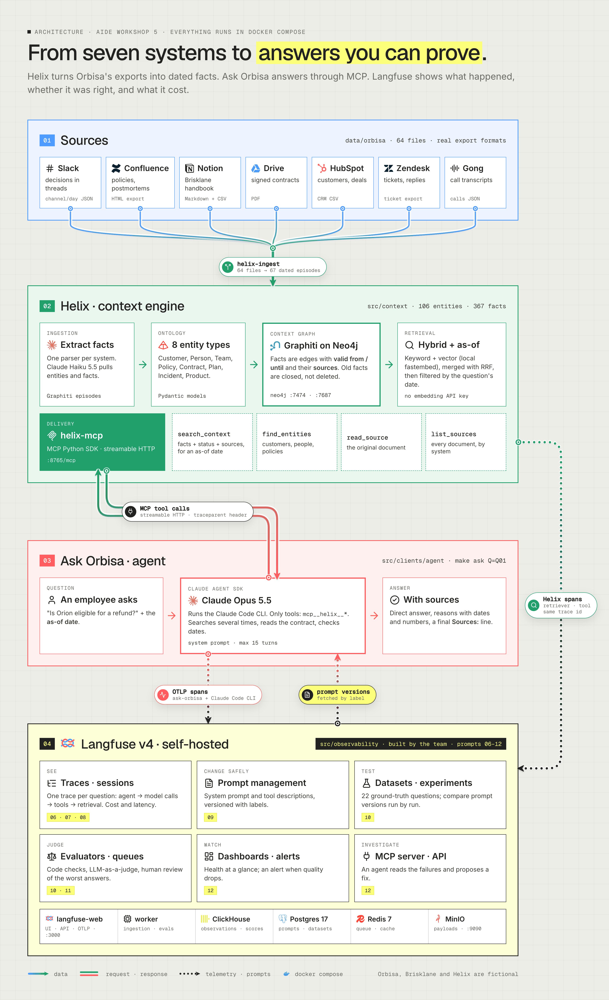

# sightline-langfuse

Observability and evaluation for an AI agent that answers questions from a temporal knowledge graph. The
agent's traces, prompts, cost, ground-truth experiments, online judges, human review and alerts all run
on a self-hosted Langfuse v4 with OpenTelemetry.

**Orbisa** is a logistics SaaS company whose knowledge is spread across seven systems. **Helix** turns
those systems into a bi-temporal knowledge graph (Graphiti on Neo4j) served over MCP. **Ask Orbisa** is a
Claude Agent SDK agent that answers employees' questions "as of" a date. Before this project, the on-call
engineer could not tell whether an answer was right, or why.

> Orbisa, Brisklane, Helix and every person and number in this repo are fictional.



## Results

All numbers are measured in Langfuse. The full readout for the CTO is in
[`decisions/03-readout.md`](decisions/03-readout.md).

| Criterion | Target | Measured |
|---|---|---|
| Every answer has one complete trace (agent → model calls → Helix tools → facts and sources) | 100% | 21/22. The CLI dropped one root span, which is a known beta limitation. |
| Correctness on temporal, conflict and false-premise questions | ≥ 0.8 | 1.0 over 2 runs. This is a ceiling, not proof: the judge is lenient. |
| Source recall | ≥ 0.8 | 0.98 |
| Cost and latency per question and per step | visible | USD 0.088 per question, p95 36.8 s |
| The LLM judge agrees with human reviewers | ≥ 5/6 | 5/6 |

The most useful finding was a defect in Helix itself. It leaked facts recorded after the as-of date
through `list_sources`, a fact's `valid_until` and entity summaries. A fix on `fix/helix-as-of` removed
every real leak in experiments. It is not merged, because the release rule could not tell its recall drops
from noise.

## What was built

| Increment | What it does | Code |
|---|---|---|
| Tracing | One trace per answer across three processes (agent, Claude Code CLI, Helix MCP server), linked by W3C `traceparent`. Each trace carries the user, session and tags, per-model cost, and email masking. | `src/observability/tracing/` |
| Prompt management | The system prompt and MCP tool descriptions are versioned in Langfuse, with labels and a local fallback, and every generation is linked to its prompt version. | `src/observability/prompts/` |
| Ground truth | A 22-question dataset, code evaluators (source recall, date leaks), a calibrated Claude Haiku judge, experiments in Docker and a release rule. | `datasets/`, `evaluators/`, `experiments/` |
| Live monitoring | An online faithfulness judge (Claude Sonnet), an annotation queue for human review, a dashboard, and a quality alert sent to a signed local webhook. | `src/observability/monitoring/` |
| Agentic access | A read-only investigator that reads runs through Langfuse's MCP server and classifies each failure as temporal, retrieval or reasoning. | `monitoring/investigate.py` |

## Key trade-offs

- **Self-hosted Langfuse, not cloud.** Traces hold customer contracts and tickets, and no customer data
  may leave the machine. The cost is running Postgres, ClickHouse, Redis and MinIO locally.
- **The CLI's own OpenTelemetry instead of wrapping the SDK.** The Claude Code CLI already emits spans
  for every model call and tool call. We propagate `traceparent` into it instead of re-instrumenting.
  This is beta: every question needs a fresh `CLAUDE_CONFIG_DIR`, or the spans stop after the first one.
- **A cheap judge offline, a strong one online.** Haiku grades correctness against references, and was
  calibrated to 22/22 before it was trusted. Faithfulness has no reference, so it runs on Sonnet with
  the documents the agent read. Haiku had returned empty reasons on long inputs.
- **A release rule fixed before the candidate runs.** A change ships only if five checks pass:
  - source recall gains beyond the run-to-run noise;
  - no item loses correctness;
  - every trace is complete;
  - date leaks do not get worse;
  - cost rises by at most 10%.

  The rule then still needs human review. It rejected a prompt that looked better but amplified a
  Helix leak.
- **Summaries in traces, not raw payloads.** Tool outputs are trimmed: documents keep a 3,000-character
  preview. This keeps traces readable and storage small. The price is that a judge that only reads the
  trace may miss text beyond the preview.
- **Fix the measurement before the model.** Several "failures" were ours, not the agent's:
  - references that asked for facts from after their date;
  - a leak detector with false positives;
  - an experiment summary that hid failed items.

  Each one is recorded in [`decisions/`](decisions/).

## Run it

Requirements: Docker Desktop (about 8 GB of free RAM), [uv](https://docs.astral.sh/uv/) and an Anthropic
API key.

```bash
cp .env.example .env     # put ANTHROPIC_API_KEY in .env, never in .env.example
make up                  # generate secrets, build Helix, start Neo4j, Helix MCP and Langfuse v4
make ingest              # load the Orbisa corpus into the graph (Claude Haiku, about 8 minutes)
make ask Q=Q01           # ask a ground-truth question through the agent
make dataset             # load the 22 questions into Langfuse
make experiment ARGS="--name my-run"   # run the dataset and score it
```

| Service | URL |
|---|---|
| Langfuse v4 | http://localhost:3000. The user and password are `LANGFUSE_INIT_USER_*` in `.env`. |
| Helix MCP server | http://localhost:8765/mcp |
| Neo4j Browser | http://localhost:7474 |
| Alert receiver | http://localhost:8787. Run `make alerts` to see what it received. |

Other targets: `make ps`, `make logs`, `make rebuild` (after changing `src/`), `make test`, `make down`.

Run the tests and the agent outside Docker:

```bash
uv sync --python 3.12
uv run pytest -q
uv run python -m clients.agent "Who approves refunds?" --as-of 2026-10-15
```

## Repository

| Path | Contents |
|---|---|
| [`decisions/`](decisions/) | The problem statement, the solution design and the readout, with every decision and its reason |
| `docs/evidence/` | Screenshots, experiment summaries and investigation reports behind each claim |
| `data/orbisa/` | Exports from Slack, Confluence, Notion, Drive, HubSpot, Zendesk and Gong, plus the ground truth |
| `src/context/` | Helix: ingestion, Graphiti on Neo4j, retrieval and the MCP server |
| `src/clients/agent/` | Ask Orbisa, the Claude Agent SDK agent |
| `src/observability/` | The observability layer described above |
| `infra/docker-compose.yml` | The whole stack, including self-hosted Langfuse |
