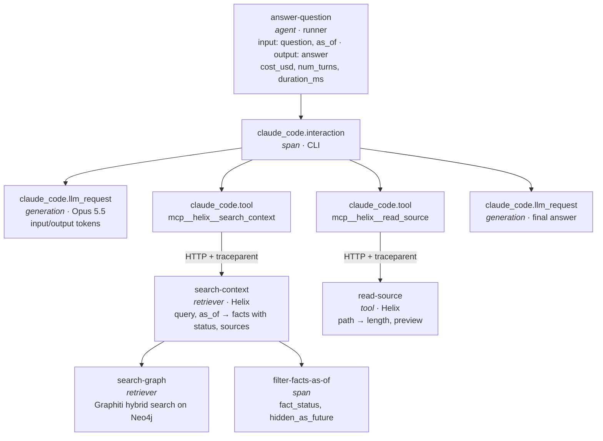

# 02 — Solution design

Status: accepted · Date: 2026-10-18 · Builds on: `01-problem-statement.md`

## Approach: B, standards first

Ask Orbisa runs as **two processes**. The Python runner starts the Claude Code CLI as a subprocess, and
the calls to the model and to Helix go out **from the CLI**, not from Python. The design follows that
split:

| Process | How it is traced | What it gives us |
|---|---|---|
| Runner (`src/clients/agent/runner.py`) | Langfuse SDK v4: one root observation per question. It passes `TRACEPARENT` to the CLI and writes cost, turns and duration from the `ResultMessage` to the root. | the trace, its attributes, and the cost per question (C4) without relying on beta spans |
| Claude Code CLI | Its own OpenTelemetry export, sent over OTLP/HTTP to `http://<langfuse>/api/public/otel` | real-time spans for every model call (tokens) and every tool call |
| Helix MCP server (`src/context/mcp/server.py`) | Langfuse SDK v4. Each tool reads the `traceparent` header the CLI sends to HTTP MCP servers and attaches its observations to that trace (`trace_context=`). | the facts, statuses and sources each tool returned (C1) |

### Verified facts the design relies on (2026-10-18)

- **Langfuse OTLP.** It accepts HTTP only (no gRPC) at `/api/public/otel`, with Basic Auth and the header
  `x-langfuse-ingestion-version=4`. A recognised `langfuse.observation.type` sets the observation type;
  otherwise a model attribute makes it a `generation`. (langfuse.com/integrations/native/opentelemetry)
- **Claude Code tracing is beta.** It is enabled with `CLAUDE_CODE_ENABLE_TELEMETRY=1`,
  `CLAUDE_CODE_ENHANCED_TELEMETRY_BETA=1` and `OTEL_TRACES_EXPORTER=otlp`.
- **Claude Code span names.** The spans are `claude_code.interaction` → `claude_code.llm_request`
  (`input_tokens`, `output_tokens`, `gen_ai.request.model`) and `claude_code.tool`. The spans carry no
  cost.
- **Claude Code trace propagation.** "Outbound HTTP MCP requests carry `traceparent`". Under the Agent SDK,
  the CLI reads `TRACEPARENT` from its environment. Content is redacted unless `OTEL_LOG_*` is set.
  (code.claude.com/docs/en/monitoring-usage)
- **Langfuse SDK v4.18.0** (installed) has `observe(as_type=…)`, `trace_context=`,
  `propagate_attributes`, `mask`, `mask_otel_spans` and `run_experiment`. The Agent SDK MCP config
  accepts `headers`.

### Fallback

The first increment is a spike. If the beta CLI spans do not arrive, or do not share the root's trace,
we switch to **C**: the OpenInference instrumentor for the agent side (a new dependency, which needs the
team's approval) and a custom header in the MCP config to link Helix. **Helix instrumentation is the same
in every option**, so no work is lost.

**Rejected options.** **A** (SDK only) reconstructs model calls from messages, so the timeline would show
durations that did not happen. **C** alone has no model-call spans and no propagation to MCP servers, so
it cannot meet C1 by itself.

## Trace of one question (Q01)

A typical Q01 run has about 10 `llm_request` spans and 9 `tool` spans; the diagram shows one of each kind.
Every observation shares one `trace_id`.

## Observation names

We control the names on the runner and Helix side. They are verb-first, kebab-case and **stable**:
evaluators, dashboards and filters depend on them, so renaming one breaks those silently. The CLI's
`claude_code.*` names are fixed by Claude Code and we keep them as they are.

| Name | Type | Where | Input → output |
|---|---|---|---|
| `answer-question` | agent | runner (root) | `{question, as_of}` → answer text |
| `report-model-usage` | generation | runner, one per model (added in increment 2) | `ResultMessage.model_usage` → tokens and the CLI's own cost for that model. A summary, not a timed call. |
| `search-context` | retriever | Helix tool | `{query, as_of, limit}` → facts (fact, status, valid_from, valid_until, source paths), `hidden_as_future` |
| `search-graph` | retriever | inside `search-context` | query → number of edges and episodes |
| `filter-facts-as-of` | span | inside `search-context` | as_of → kept vs hidden counts by status |
| `find-entities` | retriever | Helix tool | `{query, limit}` → entity names, types, summaries |
| `read-source` | tool | Helix tool | `{path}` → path, length, truncated, **preview of the first 3,000 characters** |
| `list-sources` | tool | Helix tool | — → number of documents per system |

**Trace attributes**, set on every span with `propagate_attributes`:

| Attribute | Value |
|---|---|
| name | `answer-question` |
| `session_id` | the experiment run name, or `cli` for ad-hoc questions |
| `user_id` | `cli:<os user>` or `experiment` (there is no login in the pilot) |
| metadata | `question_id`, `category`, `as_of`, `model`, `prompt_version` |
| tags | category |

**Content limits** (risk: full customer documents in traces):
- `read-source` stores a 3,000-character preview, not the full 15,000. The path and length are enough to
  check what was read.
- SDK `mask` removes secrets and emails/phone numbers (R6).
- CLI spans keep Claude Code's default redaction of prompts and tool content.

## Scores

| Score | Type | Produced by | Criterion |
|---|---|---|---|
| `trace_complete` | boolean | code check after each run: root present, at least one Helix observation under the same `trace_id`, output set | **C1** |
| `correctness` | numeric 0–1 | LLM judge (Claude Haiku 5.5) in our experiment runner: share of `expected_facts` in the answer; 0 if `trap_hit` | **C2** |
| `trap_hit` | boolean | same judge call: did the answer fall into the item's `trap`? | **C2** |
| `source_recall` | numeric 0–1 | code evaluator: share of `expected_sources` in the `Sources:` line, after mapping Helix paths to ground-truth paths | **C3** |
| `human_correctness` | numeric 0–1 | a person, in the Langfuse UI, on 6 answers (2 temporal, 2 conflict, 2 false_premise) | **C5**: agreement with `correctness` on at least 5 of 6 |

**C4 needs no score.** Cost, tokens and latency come from the observations and the Metrics API
(`/api/public/v2/metrics`), on one dashboard. It shows cost and p50/p95 latency per question, and time by
step name (`claude_code.llm_request` vs `search-context` vs `read-source`).

**Evaluators run in Python, in our experiment runner, not in Langfuse.** Self-hosted code evaluators are
TypeScript/JavaScript only. Python evaluators are versioned in git and covered by tests, which the path
mapping for C3 needs. The trade-off is that they do not run on new traces automatically: online evaluation
is stretch goal F2.

## Dataset plan

- **Source:** `data/orbisa/truth/questions.jsonl`, read only (F8: the ground truth is never edited).
- **Langfuse dataset:** `orbisa-truth` (renamed from `orbisa-ground-truth` in prompt 10), 22 items, uploaded with an upsert so re-running is safe.
  - item id = question id (`Q01`…`Q22`);
  - input = `{question, as_of}`;
  - expected output = `{expected_answer, expected_facts, expected_sources, trap}`;
  - metadata = `{category}`.
- **Runs:**
  - naming: `<prompt_version>-<model>-<YYYY-MM-DD>-<n>`;
  - **1 full run (22 items) plus a 2nd run of the 11 target questions** (temporal, conflict, false_premise), so we see the spread where C2 has targets (risk: non-deterministic agent);
  - reported **per category**, with targets only for temporal, conflict and false_premise.
- **Budget:** about USD 4.70 for increment 5 (USD 3.10 for the full run, USD 1.60 for the second run), plus the Haiku judge. During increments 0–4 we test with one question at a time (Q01, about USD 0.14). Model choices stay as they are: Opus 5.5 for the agent (inherited, the system under test) and Haiku 5.5 for the judge.

## Resilience (R2)

- The Langfuse client is enabled only when its keys are set. The CLI's OTel variables are added to the
  agent environment only in that case too.
- An unreachable Langfuse must never fail a question. The SDK exports in the background, and the CLI
  exporter drops spans it cannot send.
- Check: run a question with `HELIX_ENV_FILE` pointing at an empty file. The answer must come back, with no
  traceback.

## Build increments

| # | Increment | Prompt | Check |
|---|---|---|---|
| 0 | **Spike:** turn on CLI tracing for one question, send to Langfuse, and log the `traceparent` that Helix receives | 07 | Langfuse UI shows `claude_code.*` spans; the Helix log shows the same trace ID. If not, switch to the fallback. |
| 1 | **Trace Helix:** `search-context`, `search-graph`, `filter-facts-as-of`, `find-entities`, `read-source`, `list-sources` | 06 | `make ask Q=Q01` → Langfuse shows Helix observations with facts, statuses and source paths |
| 2 | **Trace the agent:** root `answer-question`, CLI OTel export, cost from `ResultMessage` | 07 | the Q01 trace shows `llm_request` generations with tokens, and the root shows `cost_usd` |
| 3 | **One trace, sessions, masking, resilience** | 08 | one trace per question (agent and Helix share a `trace_id`); an email in content shows as masked; the empty-env-file test passes |
| 4 | **Dataset and evaluators:** upload the 22 items; `source_recall` and `trace_complete` with unit tests | 10 | 22 items in the UI; `uv run pytest` covers path mapping |
| 5 | **Experiment:** LLM judge `correctness` and `trap_hit`; 1 full run plus a 2nd run of the 11 target questions; report per category | 10 | both runs side by side in the UI; a per-category table for C2 and C3 |
| 6 | **Judge check and dashboard:** 6 human scores (C5); cost and latency dashboard (C4) | 11–12 | agreement on at least 5 of 6; the dashboard shows cost and p50/p95 per question and per step |
| S1 | *Stretch:* prompt management, experiment v1 vs v2 (F1) | 09 | two prompt versions compared on the dataset |
| S2 | *Stretch:* online evaluation and alert (F2) | 11–12 | a forced low score raises a webhook in `alert-sink` |

## Spike result (increment 0, 2026-10-18)

**Verdict: approach B is confirmed.** The fallback to C is not needed.

Setup: one Q01 run from the host, with CLI tracing on and a fixed `TRACEPARENT`, through a temporary proxy
that logged the headers Helix received. No project code changed.

| Check | Result |
|---|---|
| CLI spans reach Langfuse over OTLP/HTTP | ✅ 33 observations under our `trace_id` |
| The CLI joins the trace we pass in `TRACEPARENT` | ✅ `claude_code.interaction` has our parent span ID |
| Types are mapped | ✅ `claude_code.interaction` → AGENT, `claude_code.llm_request` → GENERATION, tool spans → TOOL, `blocked_on_user` → SPAN |
| The model name is recognised | ✅ `claude-opus-5-5`, matched to a Langfuse model definition |
| The CLI sends `traceparent` to Helix | ✅ all 9 `tools/call` requests carry the same `trace_id`, each with its own parent span. Session setup calls (`tools/list` and others) carry none. |
| Tokens per model call | ⚠️ present only as metadata (`attributes.input_tokens`, `output_tokens`, `cache_read_tokens`, `cache_creation_tokens`). `usageDetails` and `costDetails` are **empty**, so Langfuse computes **no cost** per call. |
| Tool input and output | as expected: empty, because the CLI redacts content by default. The content comes from the Helix observations. |
| Cost per question | ✅ `ResultMessage.total_cost_usd` = USD 0.140 (10 turns, 29.9 s) |

Findings:
- **A hidden Haiku call.** One of the five generations is `claude-haiku-5-5` (1,220 input and 24 output
  tokens), made by the CLI itself. The model mix of a question is not only Opus.
- **Host runs load the user's own Claude Code settings.** A SessionEnd hook from a local plugin ran. Docker
  runs do not have them. Runs from the host can differ from Docker runs.

Consequence for increment 2: per-step **tokens** are visible but **per-step cost is not**. The options for
closing this gap for C4 are decided in increment 2.

**Decided in increment 2 (2026-10-18):** cost is recorded **per model**, as one `report-model-usage`
generation per model, using the CLI's own `costUSD` from `ResultMessage.model_usage`.
- **Why:** it gives the exact cost with no new service. Latency and token counts per `llm_request` already
  show which step dominates.
- **Rejected:** an OpenTelemetry Collector that renames the attributes would give cost per call, but it is
  one more service to run and uses Langfuse's price table instead of the CLI's. It can be added later; if
  it is, the summary generations must go, or the cost is counted twice. OpenInference has no per-call
  model spans either.

## Increment 3 result (2026-10-18)

**One trace per question, from the agent down to retrieval.**

**How the pieces are linked.** Each value takes a different route into each process:

| What | Our spans (runner) | Claude Code CLI spans | Helix spans |
|---|---|---|---|
| trace context | active span | `TRACEPARENT`, injected by the Agent SDK | `traceparent` HTTP header, read from mcp's `ctx: Context` |
| user, session | `propagate_attributes` | `OTEL_RESOURCE_ATTRIBUTES` with `langfuse.user.id`, `langfuse.session.id` | `x-orbisa-user-id` and `x-orbisa-session-id` MCP request headers |
| environment | `LANGFUSE_TRACING_ENVIRONMENT` | `langfuse.environment` in `OTEL_RESOURCE_ATTRIBUTES` | `LANGFUSE_TRACING_ENVIRONMENT` |
| tags | `propagate_attributes` | — (Langfuse expects a string array, which the variable cannot carry) | `x-orbisa-tags` header |

**Verified on Q01** (`b18db9d7297ad6f9342729f65d208cb7`):
- 9 MCP tool calls produced 9 Helix observations, each a child of its `claude_code.tool.execution` span.
- No Helix observation is a stray root.
- All 46 observations carry environment `workshop`, user `workshop` and session `inc3-check-1`. Without the
  resource attributes, the CLI's spans had environment `default`, its install id as user and its own
  session.
- Tags filter the 17 observations from our process and from Helix. The CLI's spans carry no tags, so
  filtering **traces** by tag works and filtering **observations** by tag leaves the CLI spans out.

**Masking.**
- The SDK `mask` hook replaces every email with `<email>` in input, output and metadata.
- A `read_source("slack/users.json")` call returned 12 emails to the MCP caller. Langfuse stored 0; its
  3,000-character preview holds 7 `<email>` placeholders. That file has 4,794 characters, so the preview
  limit trims it.
- The CLI's spans carry no content: `user_prompt` is `<REDACTED>`, and there is no tool input or output.
  Only the documented `OTEL_LOG_USER_PROMPTS`, `OTEL_LOG_TOOL_DETAILS`, `OTEL_LOG_TOOL_CONTENT` and
  `OTEL_LOG_RAW_API_BODIES` would add it. We leave them unset: the SDK mask would not cover those spans.

**Finding: the session-title call.** The CLI's own Haiku call (`query_source: generate_session_title`)
sometimes starts outside the `claude_code.interaction` span and lands in a separate one-span trace in the
same session.
- Its cost is not lost or double-counted: it is already in `report-model-usage`, which comes from
  `ResultMessage.model_usage`, and the stray span has no usage.
- Filters on trace name `answer-question` exclude it.

## Prompt management result (roadmap prompt 09, 2026-10-18)

The team chose to follow the roadmap order: prompt management (our stretch S1) before the dataset.

| Prompt | Source and fallback | Who reads it |
|---|---|---|
| `ask-orbisa-system` | `src/clients/agent/system_prompt.md` | the agent, per question, by label (`HELIX_PROMPT_LABEL` or `--prompt-label`, default `production`) |
| `helix-tool-<tool>` (4 prompts) | the tool docstrings in `src/context/mcp/server.py` | Helix, once at startup; a new description needs a restart |

- **Fetching:** 3-second timeout, no retries, and the local text whenever Langfuse is missing or down. A
  test proves the fallback stays under 10 seconds.
- **Recorded on `answer-question`:** `prompt_name`, `prompt_label`, `prompt_version`, `prompt_source`.
- **Linked generations:** `propagate_attributes(prompt=…)` links ours. `langfuse.observation.prompt.name`
  and `.version` in `OTEL_RESOURCE_ATTRIBUTES` link the CLI's `llm_request` spans, verified on both labels.
  Side effect: the CLI's stray session-title call is linked too, although it does not use the system
  prompt.
- **`push`:** a new version only when the text differs from the labelled one.
- **`promote`:** moves `production` **and** rewrites `system_prompt.md`, so the fallback matches
  production and the promotion is reviewed in git.
- **Who may promote:** self-hosted Langfuse has no protected labels. Agreed rule: promote only with the
  `promote` command, through a reviewed git change, and only RevOps-reviewed text gets `production`
  (brief 9h).

**State:**
- `ask-orbisa-system` v1 is `production`; v2 is `staging`. v2 adds "When a signed contract and a policy
  disagree, quote the contract clause number." (`src/observability/prompts/candidates/system-contract-clause.md`)
- Q01 on both labels: traces `65fae892…` (v1) and `bcece337…` (v2). Both answers cite clause 7.3. One
  question cannot show whether v2 is better; the dataset experiment (roadmap prompt 10) decides before
  any promotion.

## Dataset and experiments result (roadmap prompt 10, 2026-10-18)

**Decisions:**
- **Dataset name:** `orbisa-truth`, as in the roadmap, replacing `orbisa-ground-truth`.
- **Judge:** Claude Haiku 5.5, kept after calibration.
- **Runs (plan B):**
  - all 22 items on `production`;
  - the 11 target items again on `production`, to measure the noise;
  - the 11 target items on `staging`.

**Built:**
- **`datasets/load_truth.py`:** 22 items keyed `Q01…`; re-running upserts.
- **The runner records what Helix returned:** facts with status and sources, entities, documents read.
- **Code evaluators:**
  - `source_recall` (C3, from the `Sources:` line);
  - `retrieved_source_recall` (from the tool results, to tell retrieval from citation);
  - `has_sources_line`;
  - `abstained` (false_premise only, a keyword heuristic).
- **`judge.py`:** `messages.parse` with a Pydantic `Verdict`. correct / partially_correct / incorrect maps
  to 1 / 0.5 / 0, and a trap hit scores 0. Each grading is traced as `judge-answer` (evaluator) with
  `call-judge-model` (generation) inside.
- **`calibrate.py`:** 22/22 expected answers graded correct, 22/22 trap answers not correct
  (`docs/evidence/judge-calibration.json`).
- **`experiments/run.py`** (`make experiment`, in Docker): item and run evaluators, `trace_complete`
  scored from the API, a JSON summary per run. **`experiments/compare.py`:** an item-by-item diff.

**Ground-truth mismatches**, handled in the evaluators; `questions.jsonl` is unchanged:

| Expected source | What Helix serves | Items |
|---|---|---|
| `gong/calls.json` | `gong/transcripts.json` | Q06 |
| `hubspot/contacts.csv`, `hubspot/deals.csv` | `hubspot/companies.csv` | Q22, Q18 |
| `zendesk/tickets.json` | `zendesk/comments/<id>.json` | Q01, Q14 |
| a source dated after the item's `as_of` | hidden by Helix, so left out of the denominator | Q09, Q21 |

**Bug found and fixed:** in one container, after the first question the Claude Code CLI stopped exporting
its `interaction` and tool spans. Only orphaned `llm_request` spans arrived, and Helix observations became
roots: `production-full` had `trace_complete` 0.41. It is not caused by concurrency; one question at a
time failed the same way.
- **Fix:** experiments give each question's CLI a temporary `CLAUDE_CONFIG_DIR`.
- **Check:** 3/3 complete on the items that had failed.
- **Unaffected:** correctness, sources, cost and latency, which come from our side.

**Results:**

| Run | Items | Correctness (targets / floor) | source_recall | Cost/question | p95 latency | trace_complete |
|---|---|---|---|---|---|---|
| production-full | 22 | 1.0 (1.0 / 1.0), every category 1.0 | 0.98 | USD 0.0885 | 26.2 s | 0.41 (bug above) |
| production-targets-2 | 11 | 1.0 (1.0 / 1.0) | 0.975 | USD 0.0817 | 23.2 s | 1.0 |
| staging-targets | 11 | 1.0 (1.0 / 1.0) | 0.975 | USD 0.0866 | 23.1 s | 1.0 |

**Noise against change**, on the same 11 target items:

| Comparison | Item scores that changed | Mean cost | Mean latency |
|---|---|---|---|
| Same config twice (noise) | 0 | −USD 0.0006, with ±USD 0.0097 per item | −1.2 s |
| v1 → v2 (change) | 0 | +USD 0.0049 | +1.2 s |

The v2 cost and latency changes are within the noise. **v2 is indistinguishable from v1 on this dataset.**

**Reading the results:**
- **C2 and C3 pass. C1 passes after the fix. C4 is visible.**
- Correctness is at the ceiling, so on this dataset it cannot tell two prompt versions apart.
- Q04 never cites the 2023 refund page it refutes, in all 3 runs: a systematic citation gap, not noise.
- The judge was calibrated only on clear cases (verbatim reference answers and blatant traps). The human
  review (C5, roadmap prompt 11) checks the subtle ones.
- **Spend:** about USD 4.53 for the agent across all 6 runs, plus the Haiku judge and calibration.

## Online evaluation and human review result (roadmap prompt 11, 2026-10-20)

**Decisions:**
- **Faithfulness judge on Claude Sonnet 5.5.** It started on Haiku, but with document excerpts in the
  prompt (about 6,000 tokens) Haiku returned scores with an empty or `placeholder` explanation.
- **Pass document excerpts to the judge.** With the graph facts alone it penalised every claim taken from
  a document the agent read.
- **`future_date_leak` added** (code, experiments).
- **v2 of the system prompt not promoted.**

**Built:**
- **On `answer-question`:** `helix_facts`, `helix_sources_read` and `helix_documents` (a 3,000-character
  excerpt per document read, masked).
- **`monitoring/setup.py`**, idempotent through the public API:
  - an Anthropic LLM connection;
  - score configs `human_correctness` (categorical), `faithfulness` (0–1) and `has_sources_line`;
  - the queue `orbisa-review`;
  - the evaluators `faithfulness` (LLM judge, now version 3) and `has-sources-line` (TypeScript);
  - the rule `answer-question live` (every `answer-question` in `workshop`, 100%).

  The human score is `human_correctness`, not `correctness`: the experiment judge already writes a
  numeric `correctness`.
- **`monitoring/review.py`:** queue the lowest live answers and C5 samples, show, record a verdict,
  turn a trace into an `orbisa-reviewed` item, and report agreement.

**`future_date_leak`:** it flags a date after `as_of` that is the recording date of a source document.
- On stored runs it flags Q05, Q21 (both runs) and Q09; the judge rated all of them correct.
- The reference answers of Q03 and Q09 mention such dates themselves, so the judge may reward leaks. The
  ground truth is unchanged.

**Live (5 questions, one session):**
- Scores arrived automatically.
- With facts only, faithfulness was 0.25–0.6. With document excerpts and Sonnet, the Platinum question
  scored 0.88, and the judge named the two claims the retrieved material does not support.

**Human review:**
- 7 verdicts: the live Platinum answer `partially_correct` (it leads with Brisklane's 60 days, the Q13
  trap); Q03, Q02, Q08, Q13 and Q14 `correct`; Q04 `partially_correct`.
- **C5 agreement: 5/6 (target ≥ 5/6).** The disagreement is Q04: the judge gave `correct` while noting
  the missing 14-day window. This is direct evidence that the correctness judge is lenient.
- The live Platinum answer became the first `orbisa-reviewed` item, with its source trace.
- One live item (Orion approval) is still pending in the queue.

## Dashboard and alert result (roadmap prompt 12, part A, 2026-10-21)

**Dashboard "Ask Orbisa"**, built by `monitoring/dashboard.py create` through the unstable dashboards API.
It has five widgets, each tested first against the Metrics API v2:
- questions per day;
- p95 latency by step (`answer-question`, `claude_code.llm_request`, `search-context`);
- mean cost per question by model (`report-model-usage`);
- tool calls by tool;
- mean faithfulness, correctness and source_recall over time.

`dashboard report --hours N` prints the same numbers per question in the terminal. Last 7 days: 68
questions, USD 0.091 per question (Opus USD 0.092, Haiku USD 0.0001), 6.6 tool calls per question, p95
33.7 s for the agent, 10 s per model call and 1.3 s for `search-context`.

**Alert "Ask Orbisa faithfulness"** (created in the UI; alerts are UI-only):
- **Metric:** Scores (numeric) → Value → **Avg**, filtered on Environment = `workshop` and Score Name =
  `faithfulness`.
- **Thresholds:** below 0.8 is ALERT, below 0.9 is WARNING, over 1 hour.
- **No data:** `Show severity NO_DATA`. The default treats missing data as 0, which would fire every quiet
  hour.
- **Channel:** a webhook to `http://alert-sink/langfuse`.
  - Langfuse allows only ports 80 and 443 and blocks private hosts unless whitelisted
    (`LANGFUSE_WEBHOOK_WHITELISTED_HOST` and `LANGFUSE_WEBHOOK_ALLOWED_HOSTS` = `alert-sink`).
  - The HMAC secret is in `.env` (`ALERT_WEBHOOK_SECRET`).

**The 4.63 UI differs from the docs:**
- the alert webhook is created from Alerts → "Connect Webhooks"; Automations → Create offers only Prompt
  events;
- the form's Aggregation field appears only after the View is chosen.

**Drill:**
- `ask-orbisa-system` v3, label `drill`, tells the agent to answer from memory without tools.
- Claude Opus 5.5 used the tools anyway, but faithfulness on the three drill questions was 0.73, 0.94 and
  0.62 (mean 0.76).
- First the alert stayed OK: it had been saved with Aggregation = Count and no filters, so it counted
  every score.
- After the fix it moved to **ALERT** within 30 seconds. `alert-sink` received a `monitor-alert` with
  `severity: ALERT` and the right filters, **signature verified**, and with no customer data in it
  (`docs/evidence/inc7-alert-payload.json`).

## Open questions for the team

- ~~`read-source` preview size~~ — decided 2026-10-18: **3,000 characters**.
- ~~Run budget~~: decided 2026-10-18: 1 full run plus a 2nd run of the 11 target questions (about USD 4.70 plus the judge).
